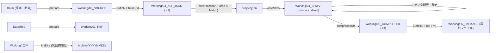

# SheepWeave データ構造＆物理ディレクトリ仕様書 (DATA_STRUCTURE.md)

SheepWeave における統合プロジェクトデータ（`project.json`）のスキーマ仕様、物理ディレクトリ構成、およびデータのライフサイクル・互換性ハンドリングを規定します。

---

## 1. 物理ディレクトリ構成

SheepWeave プロジェクトは以下の階層構造で構成されます。

```
<WorkspaceRoot>/
├── project.json                   # 唯一の真実 (Single Source of Truth) となる統合データ
├── workflow.ini                   # ワークフロー設定（index, role, name, segmentation等）
│
├── Data/                          # ユーザーが投入する元データ
│   ├── (元ファイル: .docx, .xlsx, .xlf など)
│   └── Ref/                       # 参考資料（TM: .tmx / TB: .tbx, .json）
│       ├── TM/                    # 翻訳メモリ
│       └── TB/                    # 用語集
│
├── Archive/                       # プロジェクト初期化時に自動退避される過去作業履歴
│   ├── 20261017/                  # 日付ごとのアーカイブフォルダ（重複時は枝番 _1, _2...）
│   └── 20261017_1/
│
├── Working/                       # 現在進行中の作業領域
│   ├── 01_REF/                    # 参照データキャッシュ (TMX, TBX, phrase.jsonl)
│   ├── 02_SOURCE/                 # 翻訳対象の原本ファイル（Data/ からコピー）
│   ├── 03_XLF_JSON/               # Tikal抽出された中間 XLIFF ファイル
│   ├── 04_SHWV/                   # エディタ用テキストファイル (Source.shwvs, Target.shwvt)
│   ├── 05_COMPLETED/              # 翻訳完了後の最新 XLIFF
│   ├── 06_PACKAGE/                # 元ファイル形式へ埋め戻された最終納品成果物
│   └── 99_MANAGE/                 # 分割・インポート・エクスポート作業用領域
│
├── prompts/                       # LLM翻訳用のカスタムプロンプト定義ファイル
└── filters/                       # Okapi Framework 向けのカスタムフィルタ (.fprm)
```

### ディレクトリ間のデータ遷移フロー



---

## 2. 統合データスキーマ (`project.json`)

Ver 1.1 以降、SheepWeave では個別キャッシュファイルを廃止し、ワークスペースルートの `project.json` が**翻訳テキスト、プロジェクト設定、ワークフロー、統計情報を包含する唯一のファイル**として動作します。

### 完全な JSON 構造例

```json
{
  "define": {
    "name": "SHWV_DATA",
    "version": "1.5"
  },
  "meta": {
    "bilingualPath": "Working/03_XLF_JSON/Sample.mxliff",
    "files": [
      {
        "name": "Sample.docx",
        "start": 0,
        "end": 99
      }
    ],
    "sourceLang": "en-US",
    "targetLang": "ja-JP",
    "projectName": "SampleProject",
    "tmFiles": [ "Working/01_REF/TM/reference.tmx" ],
    "tbFiles": [ "Working/01_REF/TB/glossary.tbx" ],
    "workflow": {
      "index": 1,
      "role": "Translation",
      "name": "Sheep",
      "segmentation": "line",
      "range": "1-100",
      "files": ["Sample.docx"]
    }
  },
  "body": {
    "units": [
      {
        "idx": 1,
        "src": "Welcome to SheepWeave.",
        "pre": "SheepWeaveへようこそ。",
        "tgt": "SheepWeaveへようこそ。",
        "status": 1,
        "note": "見出しセグメント @md[[{\"img\":\"imgs/p01.png\"}]]",
        "isSub": false,
        "isPeRef": false,
        "ref": {
          "tms": [
            {
              "src": "Welcome to SheepWeave.",
              "tgt": "SheepWeaveへようこそ。",
              "sim": 100,
              "source": "reference.tmx"
            }
          ],
          "tb": [
            {
              "src": "SheepWeave",
              "tgt": "SheepWeave"
            }
          ],
          "quoted": [],
          "quoted100": []
        },
        "placeholders": {
          "0": "{0}"
        }
      }
    ],
    "terms": [
      {
        "src": "SheepWeave",
        "tgt": "SheepWeave"
      }
    ]
  },
  "projectInfo": {
    "version": 2,
    "projectName": "SampleProject",
    "sourceLanguage": "en-US",
    "targetLanguage": "ja-JP",
    "sourceFiles": [
      "Sample.docx"
    ],
    "okapi": [
      {
        "filter": "auto",
        "files": [
          {
            "source": "d:\\...\\Working\\02_SOURCE\\Sample.docx",
            "xliff": "d:\\...\\Working\\03_XLF_JSON\\Sample.docx.xlf",
            "status": "extracted"
          }
        ]
      }
    ],
    "lastPreparedAt": "2026-10-17T12:00:00.000Z",
    "stats": {
      "segments": 100,
      "untranslated": 25,
      "qaWarnings": 0,
      "termsMatched": 14
    }
  }
}
```

---

## 3. 主要プロパティ定義

### `define` (`ShWvDefine`)
- `name`: 固定文字列 `'SHWV_DATA'`
- `version`: スキーマバージョン（`'1.0'` 〜 `'1.5'`）

### `meta` (`ShWvMeta`)
- `files`: マルチファイル構成時の各元ファイルとセグメント範囲（`start` 〜 `end` インデックス）の対応表。
- `sourceLang` / `targetLang`: 言語コード（BCP-47 準拠）。
- `workflow`:
  - `index`: 現在の工程番号（0: 抽出, 1: 翻訳, 2: レビュー等）
  - `role`: 担当ロール（"Translation", "Review" 等）
  - `segmentation`: 抽出・分割モード（`'line'` / `'seg'` / `'raw'`）
  - `range`: 担当セグメント範囲（例: `"1-100, 201-300"`）
  - `files`: 担当対象ファイル名

### `body.units` (`ShWvUnit`)
各翻訳セグメントのデータ本体。
- `idx`: セグメント番号（1始まり）
- `src`: 原文テキスト
- `tgt`: 訳文テキスト（エディタでの編集対象）
- `pre`: 機械翻訳や初期訳文
- `status`: 確定ステータス（0: 未確定, 1以上: 確定済み）
- `note`: 原文ファイル由来のコメント・指示。マルチメディア連携用の `@md[[...]]` メタデータを含む。
- `memo`: ユーザー定義の備考・指示メモ（Ver 1.5 で追加。翻訳タブで自由に編集・保存可能）。
- `ref`: TM一致候補（`tms`）、用語集一致候補（`tb`。推奨訳 `tgts` および使用禁止用語 `forbiddens` を保持）、引用符一致情報。
- `placeholders`: タグ保護用のプレースホルダー対応表。

### `projectInfo` (`ProjectInfo`)
Okapi Tikal の抽出設定およびステータス。
- `okapi`: 使用したフィルタ設定と、各原文ファイル・抽出先 XLIFF のパス・ステータス（`extracted`, `merged` 等）。
- `stats`: セグメント総数、未翻訳数、用語一致数などのプロジェクト統計。

---

## 4. 後方互換性ハンドリング

古いバージョンのプロジェクトファイルを開いた場合でもデータが破損しないよう、`ProjectManager` および `ShWvData` ローダーは以下の順序で互換性を自動解決します。

1. **最新統合形式 (Ver 1.1〜1.5)**: `define.name === 'SHWV_DATA'` かつ `projectInfo` を含む場合、最新形式として即座にメモリに展開。
2. **移行形式 (Ver 1.0)**: `define.name === 'SHWV_DATA'` だが `projectInfo` が外部にある場合、それを自動結合。
3. **レガシー形式 (Ver 1.0 未満の旧 project.json)**: ルートに `projectName` が直接置かれている旧形式を検出した場合、自動的に Ver 1.5 形式へ内部変換し、保存時（`save()`）に最新の統合構造へ透過的にアップグレード。
