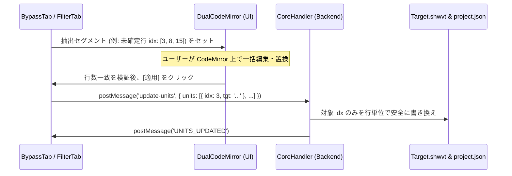

# SheepWeave エディタ保護＆バイパス編集設計書 (EDITOR_DESIGN.md)

テキスト編集体験の向上と、CATツールにおける最も致命的な「行ズレ事故」を100%防止するためのエディタ保護機構・バイパス編集機構の設計仕様書です。

---

## 1. 概要・設計思想

SheepWeave は、VS Code のネイティブエディタ（`.shwvt` / `.shwvs`）による超高速なテキスト編集と、Webview（Vue 3 + CodeMirror 6）によるインテリジェントな支援機能を組み合わせています。

### 解決する課題
1. **行ズレ事故の絶対防止**：CATツールでは、改行が1つ挿入・削除されるだけで以降の全セグメントの原文・訳文の対応が崩壊します。
2. **安全なサブセット編集**：未確定行や特定キーワードで抽出した一部セグメントのみを外部ツールや一括置換で編集し、安全に正本（`.shwvt`）へ書き戻す。
3. **高パフォーマンス**：セグメントが数千行におよぶ場合でも DOM 仮想化（CodeMirror 6）によりカクつかずに高速動作。

---

## 2. 🛡️ メインエディタ保護 (`src/features/editorGuard.ts`)

VS Code のネイティブエディタで `.shwvt` や `.shwvs` を編集する際、以下の自動保護が常時稼働します。

- **行数変更の禁止**: ユーザーが `Enter` キーを押して改行を挿入したり、`Backspace` や `Delete` で行を結合・削除した場合、`editorGuard` がドキュメントの行数変化を検知して即座に `vscode.commands.executeCommand('undo')` を発行し、警告トーストを表示します。
- **ファイルオープンセーフガード**: ワークフローの変換時やデータ再ロード時に、開かれているエディタをあらかじめ自動保存＆クローズ（`saveAndCloseWorkingEditors`）することで、ファイル競合や不整合を防ぎます。
- **セル内・セグメント内改行のエスケープ（`{@n}` / `{@r}`）**: セグメント分割なし（`-seg=false`）の Excel セル内改行や段落内改行は、`Target.shwvt` / `Source.shwvs` 出力時に `\n` ➔ `{@n}`、`\r` ➔ `{@r}` へ自動エスケープされます。これによりエディタ上の行数ズレを物理的に防ぎ、確定・保存時に可逆復元されます。

---

## 3. 🛡️ Webview バイパスエディタの3重防壁セーフティロック

Webview 側のバイパスエディタ（`DualCodeMirror.vue` / `SingleCodeMirror.vue`）では、以下の3段階の防壁により行ズレを物理的に遮断します。

```
[ 入力フェーズ ]  第1防壁：Enterキー無効化 & ペースト時の改行置換
       │
       ▼
[ 検証フェーズ ]  第2防壁：原文行数 vs 訳文行数のリアルタイム比較＆警告表示
       │
       ▼
[ 反映フェーズ ]  第3防壁：行数が完全一致しない限り「適用 (Apply)」ボタンをハードロック
```

### 第1防壁：入力・ペースト時の改行インターセプト
- **Enterキーのブロック**: CodeMirror の `keymap` で Enter キー単体の改行挿入を抑制。「セグメント内の改行は禁止されています」とツールチップを表示。
- **ペースト時のサニタイズ**: クリップボードから複数行テキストが貼り付けられた場合、トランザクションフィルターにより自動で半角スペースや `{/}` に置換して挿入。

### 第2防壁：リアルタイム行数検証＆視覚警告
- 原文ペインの行数（`sourceLines`）と訳文ペインの行数（`targetLines`）を常時監視。
- 行数が一致しない場合：
  - エディタヘッダーが警告色（Amber/Red）に変化。
  - バッジ表示：`原文: 12行 / 訳文: 13行（行数が一致していません！）`
  - ズレが生じた行以降を視覚的にハイライト。

### 第3防壁：適用（Apply）ボタンのハードロック
- **「原文行数 === 訳文行数」が完全に成立している場合のみ**、「適用（Apply）」ボタンがアクティブ（緑色）になります。
- 1行でもズレている間はボタンが完全に無効化（`disabled`）され、事故データを正本（`.shwvt`）に書き戻すことを防止します。

---

## 4. バイパス翻訳のデータフロー



---

## 5. 実装コンポーネント構成

- **`webview/src/components/common/DualCodeMirror.vue`**: 左右2ペインの CodeMirror 6 エディタ。スクロール同期、行数ガード、行ハイライト機能を内包。
- **`webview/src/components/subeditor/SingleCodeMirror.vue`**: 単一セグメント編集用の CodeMirror 6 コンポーネント。
- **`webview/src/tabs/BypassTab.vue`**: 未確定行抽出、類似度クラスタリング抽出、キーワード検索結果をバイパス編集する専用画面。
