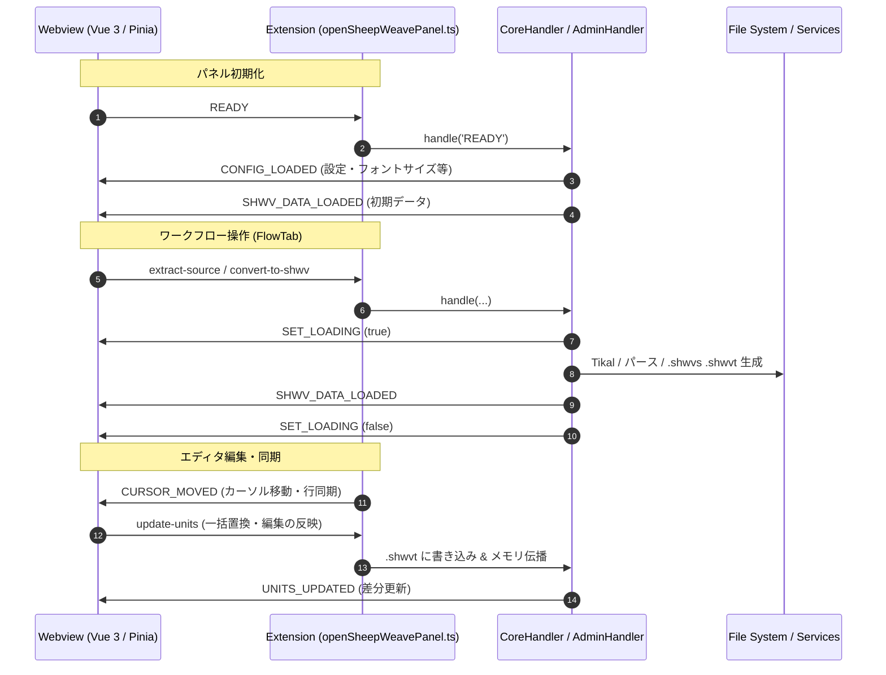
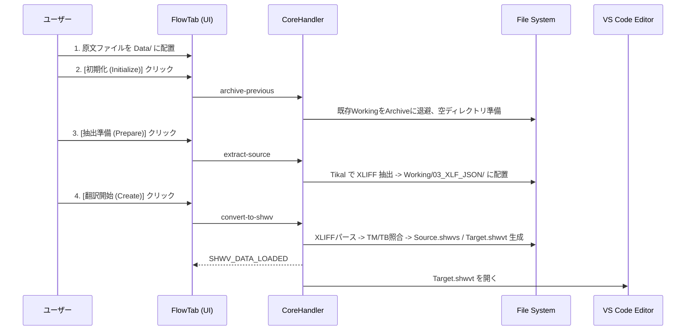

# SheepWeave イベント＆メッセージ通信仕様書 (EVENTS.md)

VS Code 拡張機能（Extension）とサイドパネル（Webview）の間でやり取りされるメッセージ仕様、データ通信シーケンス、ライフサイクルの定義書です。

---

## 1. 通信アーキテクチャ

Extension と Webview は VS Code の `postMessage` API を用いてメッセージを非同期に交換します。

---

## 2. Webview ➔ Extension (送信メッセージ)

Webview の `App.vue` (`handleCommand` 等) から `vscode.postMessage({ type, payload })` で送信されます。

### A. ワークフロー制御 (`FlowTab.vue` / `CoreHandler`)

| メッセージ型 (`type`) | ペイロード (`payload`) | 説明 |
| :--- | :--- | :--- |
| `open-current` | なし | ワークスペースのルートフォルダを OS のファイラーで開く |
| `open-workflow-ini` | なし | `workflow.ini` をエディタで開く（存在しなければ新規作成） |
| `archive-previous` | なし | 現在の `Working/` を `Archive/` に退避し初期化 (`initDirs`) |
| `setup-agent-rules` | `{ overwrite?: boolean }` | AIエージェント設定ファイル（`.cursorrules` 等）をルートに自動生成 |
| `init-from-project-json` | なし | カレントルートの `project.json` を安全に維持したままフォルダ構造生成とデータ展開を行いエディタを開く |
| `extract-source` | `{ projectName, sourceLang, targetLang, useFprmFilter?, selectedFilterFile? }` | `project.json` 作成と Tikal による原文からの XLIFF 抽出 |
| `convert-to-shwv` | `{ segmentation?, range?, files? }` | XLIFF を解析し、`.shwvs` / `.shwvt` を生成してデータをロード |
| `load` | なし | 既存の作業中プロジェクト（`Working/` が存在する前提）の `project.json` を再読み込み、Webview・エディタに同期 |
| `add-files` | なし | `Working/02_SOURCE` に追加されたファイルのみを増分パースして末尾に追加 |
| `reanalyze` | なし | `01_REF` の TM/TB を再スキャンし、全セグメントの照合と類似度を再計算 |
| `export-xliff` | なし | `.shwvt` の内容を XLIFF 形式 (`05_COMPLETED`) へ書き出す |
| `merge-to-final` | なし | XLIFF を元のファイル形式（Office/XML等）に埋め戻し、最終成果物を生成 |
| `advance-workflow` | `{ nextRole, nextName }` | ワークフローのステップを進める |

### B. エディタ・翻訳操作 (`TranslateTab`, `FilterTab`, `BypassTab`)

| メッセージ型 (`type`) | ペイロード (`payload`) | 説明 |
| :--- | :--- | :--- |
| `READY` | なし | Webview 起動完了通知。設定と最新データの送信を要求 |
| `update-units` | `{ units: [{ idx, tgt, note?, status? }] }` | 訳文ユニットの更新。`.shwvt` への差分書き込みと TM 伝播を実行 |
| `update-config` | `{ key, value }` | 設定（フォントサイズ、テーマ等）を VS Code 設定に永続化 |
| `goto-line` | `{ line: number }` | エディタ（`.shwvt`）の指定行へカーソルをジャンプ |
| `toggle-pe-ref` | `{ idx: number }` | ポストエディット（PE）参照フラグの切り替え |
| `update-unit-memo` | `{ idx: number, memo?: string }` | ユーザーメモの更新・`project.json` への永続化 |
| `propagate-quoted` | `{ idx: number, text: string }` | 引用符内の一括反映 |
| `save-and-propagate` | なし | 現在の編集内容を保存し、同一文のセグメントへ一括伝播 |

### C. 検索・コンコーダンス (`SearchTab.vue`)

| メッセージ型 (`type`) | ペイロード (`payload`) | 説明 |
| :--- | :--- | :--- |
| `manual-concordance` | `{ query: string, mode: 'source' \| 'target' }` | 手動での TM/TB/プロジェクト内コンコーダンス検索 |

### D. LLM 支援・バッチ翻訳 (`LlmTab.vue`)

| メッセージ型 (`type`) | ペイロード (`payload`) | 説明 |
| :--- | :--- | :--- |
| `run-llm-request` | `{ prompt, context }` | 単一セグメントに対する LLM 翻訳リクエスト |
| `run-llm-chat-request` | `{ messages, systemPrompt }` | 翻訳アシスタントとのチャットリクエスト |
| `run-llm-batch-request` | `{ units, promptTemplate, options }` | 複数セグメントに対するバッチ翻訳実行 |
| `cancel-llm-batch` | なし | 実行中のバッチ翻訳を中断 |
| `apply-llm-results` | `{ results: [{ idx, tgt }] }` | LLM の翻訳結果を一括でエディタに適用 |
| `clear-llm-tms` | なし | LLM 参照用キャッシュのクリア |
| `export-prompt` | `{ promptContent }` | プロンプト定義をファイルへ保存 |
| `import-prompt` | なし | 保存されたプロンプト定義をインポート |
| `scan-prompt-files` | なし | `prompts/` フォルダ内のプロンプトファイルをスキャン |

### E. バックアップ・設定 (`ToolsTab.vue` / `CoreHandler`)

| メッセージ型 (`type`) | ペイロード (`payload`) | 説明 |
| :--- | :--- | :--- |
| `create-backup` | `{ note?: string }` | プロジェクト全体のバックアップを作成 (`backupOps.ts`) |
| `list-backups` | なし | 作成済みバックアップの一覧を取得 |
| `restore-backup` | `{ backupName: string }` | 指定バックアップからプロジェクト状態を復元 |
| `open-backup-folder` | なし | バックアップフォルダを OS のファイラーで開く |
| `scan-filter-files` | なし | `filters/` フォルダ内の Okapi `.fprm` フィルタを一覧取得 |

### F. データ管理・外部出力 (`ToolsTab.vue` / `AdminHandler`)

| メッセージ型 (`type`) | ペイロード (`payload`) | 説明 |
| :--- | :--- | :--- |
| `shuttle-export-review-html` | なし | 校閲・レビュー用の見やすい HTML レポートを出力 |
| `shuttle-export-json` | なし | 翻訳データを JSON 形式でエクスポート |
| `shuttle-export-csv` | なし | 翻訳データを CSV 形式でエクスポート |
| `shuttle-export-jsonl` | なし | AI/LLM 連携用 JSONL 形式でエクスポート |
| `shuttle-chunk-jsonl` | `{ chunkSize: number }` | 指定サイズで JSONL を分割出力 |
| `shuttle-import-jsonl` | なし | 外部編集された JSONL を読み込みプロジェクトに反映 |
| `shuttle-split-file` | なし | 元のファイルごとにデータを個別分割 |
| `shuttle-split-length` | `{ length: number }` | 指定セグメント数ごとにプロジェクトを分割 |
| `shuttle-auto-replace` | `{ rules }` | 正規表現等による一括自動置換 |

---

## 3. Extension ➔ Webview (受信メッセージ)

Extension から `panel.webview.postMessage({ type, data })` で送信され、Webview の `App.vue` で処理されます。

| メッセージ型 (`type`) | 受信先 / 担当 | データの詳細 |
| :--- | :--- | :--- |
| `CONFIG_LOADED` | `App.vue` (`config`) | VS Code の設定値（フォントサイズ、デフォルト言語、UIテーマ等） |
| `SHWV_DATA_LOADED` | `shwvStore` | プロジェクト全体のデータ（`define`, `meta`, `body.units`, `body.terms`, `projectInfo`） |
| `UNITS_UPDATED` | `shwvStore` | 更新されたセグメントの差分配列（`units: ShWvUnit[]`） |
| `CURSOR_MOVED` | `shwvStore` | `{ line: number, text: string }` エディタの選択行に連動してUIを自動スクロール・選択 |
| `SET_LOADING` | `App.vue` (`loading`) | `boolean` (ローディングスピナーの表示 / 非表示) |
| `SELECT_TAB` | `App.vue` (`activeTab`) | `'flow'` \| `'translate'` \| `'search'` \| `'bypass'` \| `'tools'` \| `'llm'` \| `'information'` \| `'settings'` |
| `OPEN_SUB_EDITOR` | `App.vue` | 指定セグメントのサブエディタモーダルを開く |
| `CONCORDANCE_SEARCH_RES` | `SearchTab.vue` | コンコーダンス検索結果のリスト（TM一致、TB一致、プロジェクト内一致） |
| `SETUP_AGENT_RULES_SUCCESS`| `App.vue` | AIエージェント設定ファイルの配置結果（作成ファイル・スキップ一覧） |
| `FILTER_FILES_SCANNED` | `FlowTab.vue` | 利用可能な `.fprm` フィルタ一覧 |
| `PROMPT_FILES_SCANNED` | `LlmTab.vue` | 利用可能なプロンプトファイル一覧 |
| `PROMPT_IMPORTED` | `LlmTab.vue` | インポートされたプロンプト内容 |
| `LLM_RESPONSE` / `LLM_ERROR` | `LlmTab.vue` | 単一 LLM 翻訳の結果またはエラー情報 |
| `LLM_CHAT_RESPONSE` / `ERROR`| `LlmTab.vue` | LLM チャットの返答またはエラー情報 |
| `LLM_BATCH_LOG` / `PROGRESS` | `LlmTab.vue` | バッチ翻訳の進捗率・ログ文字列 |
| `LLM_BATCH_DONE` / `ERROR` | `LlmTab.vue` | バッチ翻訳の完了通知（結果ユニット一覧）またはエラー |

---

## 4. 主要ライフサイクルフロー

### プロジェクト作成〜翻訳開始フロー

